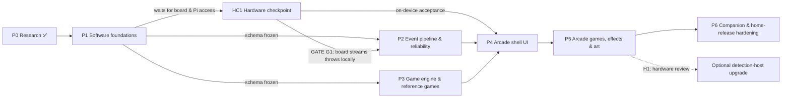

# AutoDarts Arcade — Roadmap

> **Companion documents:** [ARCHITECTURE.md](ARCHITECTURE.md) (design and evidence) · [RISK-REGISTER.md](RISK-REGISTER.md) (risks R01–R27).
> Phase 0 is complete when these three documents are accepted. Phases 1–6 below, with hardware checkpoint HC1, are the implementation roadmap. **No code or deployment happens until Phase 1 is approved.**

---

## Phase 0: Research and architecture (this deliverable) ✅

| Deliverable | Where |
|---|---|
| AutoDarts architecture, versions, licensing, integration methods | ARCHITECTURE §4.1–4.4 |
| ludarts / IO-Darts-Agent review (+ the projects that actually matter) | ARCHITECTURE §4.5 |
| Live dart, miss, correction, takeout and reconnection handling | ARCHITECTURE §6 |
| React (Native) / TypeScript architecture with a modular engine | ARCHITECTURE §5, §8 |
| Normalized event schema | ARCHITECTURE §7 |
| Raspberry Pi 4 assessment and rendering placement | ARCHITECTURE §4.6, ADR-001 |
| Six-phase roadmap | this file |
| Wireframes W0–W5 | ARCHITECTURE §10 |
| Technical risk register | RISK-REGISTER.md |

### Owner decisions (answered 2026-10-26)

| # | Question | Answer → consequence |
|---|---|---|
| **Q1** | Which Fire TV Stick? | **Fire TV Stick 4K Max.** Both generations run **Fire OS** (1st gen 2021: Fire OS 7; 2nd gen 2023: Fire OS 8; 2 GB RAM each) ✅[P1]. The stick runs the **same Android build** as phones. The Vega track drops to an optional backlog item (R04, R05) |
| **Q2** | Private use or public store listing? | **Private home use.** No store listings. Fire TV Stick 4K Max and Android: APK sideloaded via ADB ✅[P26]. iPhone and iPad: **TestFlight internal testing** on the owner's paid Apple Developer account |
| **Q3** | Commercial or venue use? | **No.** Owner reports that Autodarts staff permitted private home use via their Discord. *Owner-attested; not independently verified.* Keep a screenshot or link of that permission (R03) |
| **Q4** | GPL app-store exception? | **Not needed for private use.** You are the sole copyright holder, so the GPL doesn't restrict your own installs. Revisit only before accepting outside contributions or publishing (R07) |
| **Q5** | Product name | **Keep "AutoDarts Arcade"** for home use. Revisit only if it's ever published (R08) |
| **Q6** | Upgrade the detection host if the Pi 4 proves unreliable? | **Only after Phase 5, and only if proven.** P1–P5 must work on the current Pi 4. Evidence is collected throughout, and the **H1 hardware review** after P5 decides (see below) |
| **R** | How is uncertain history reconciled after a reconnect? | **Flag it, and pause when a takeout may have been missed.** Same-visit recovered darts are scored and the turn is flagged `needsReview`. An inferred takeout ends the turn `needsReview` with no padded misses, and the next turn waits until a person confirms (`ConfirmTurn`). A session can't close as completed while a flagged turn is unconfirmed (ARCHITECTURE §6.4) |
| **S** | May the app ever write to the board (for example, reset a stuck takeout)? | **No.** The transport allows only GET `/api/state`, `/api/version`, `/api/state/stats`, `/api/cams/stats` and `WS /api/events`. A stuck takeout is reset from Autodarts' own app, and Arcade offers manual entry meanwhile (ARCHITECTURE §4.3, §6.3, §9.5) |

---

## Dependency overview

- **P2 and P3 run in parallel** once the event schema (P1) is frozen. P3 develops against the simulator adapter and scripted fixtures (recorded ones once HC1 has them), so it doesn't need P2's live adapter.
- **HC1 runs when the board and the Pi are reachable again.** Until then P2 builds and tests everything against the simulator and the fault proxy. P2's live adapter is only called done, and P4's on-device acceptance only starts, once HC1 has passed.
- **Vega:** not on the critical path, because your 4K Max runs Fire OS. It becomes relevant only if the stick is replaced, since newer sticks run Vega. See the *Backlog* at the end of this file.

| Phase | Depends on | Unblocks | Gate to exit |
|---|---|---|---|
| P1 | P0 accepted (Q1–Q6 answered) | P2, P3, HC1 | CI green on `main`, native builds included |
| HC1 | P1 (app and native builds) + access to the board and the Pi | P2's live adapter, P4's on-device acceptance | **G1** go/no-go on the local throw stream |
| P2 | P1 (schema); HC1 (G1 = go) for the live adapter | P4 | Chaos suite green; live adapter proven on HC1 fixtures |
| P3 | P1 (schema) | P4 | Replay-equivalence suite green |
| P4 | P2, P3; HC1 for on-device acceptance | P5 | Full game playable on every device class |
| P5 | P4 | P6, H1 | Performance budgets met on the weakest target |
| H1 | P5 + health data from P2–P5 | optional hardware upgrade | Written upgrade / no-upgrade decision |
| P6 | P5 | home release | Soak test, installed on all your devices |

---

## Phase 1: Software foundations

**Goal:** stand up the skeleton everything else builds on. Nothing in this phase needs the board or the Pi.

Phase 1 used to include the hardware work as well. The owner can't reach the board or the Pi for now, so items 1–3 and 7 moved to **hardware checkpoint HC1** (below). Item numbers are kept, so existing references still hold.

**Status (2026-10-26):**
- **Done:** items 4–6 and 8. That covers the monorepo with CI, `event-schema` v1 with tests, the app skeleton on Expo SDK 56 + `react-native-tvos` ([ADR-003](docs/adr/0003-client-stack-versions.md)), and `CONTRIBUTING.md`.
- **Done early:** the app skeleton also carries the **visual shell** for all of W0–W5, driven by demo darts and checked in the web preview. This pulls P4's layout work forward; P4 still owns wiring the shell to the engine, profiles and the acceptance criteria.
- **Added, not yet proven:** item 9, native build CI. It only counts as done once the workflow is green on GitHub.
- **Moved:** the live "dart ticker" moves to Phase 2, because it needs the live adapter.

**Scope**
- **4. Monorepo:** Yarn workspaces, TS strict, ESLint dependency rules (§5.3), Vitest, and CI (lint, typecheck, unit tests).
- **5. `packages/event-schema` v1:** zod types and JSON Schema generation. Validating the recorded fixtures moves to HC1, item 2.
- **6. App skeleton** (`apps/arcade`, Expo + `react-native-tvos`):
  - builds for iPhone, iPad, Android and the **Fire TV Stick 4K Max** (TV profile), proven in CI by item 9;
  - W0 connect screen.
- **8. Repo housekeeping:** add a `CONTRIBUTING.md` with the code-reuse rule (ARCHITECTURE §4.5), so the private-use licence position stays clean.
- **9. Native build CI** (`.github/workflows/native.yml`): Expo prebuild plus a real compile for Android phone, Android TV (`EXPO_TV=1`) and the iOS simulator, on every push that touches code. The web export in `ci.yml` never exercises `react-native-tvos`, the TV manifest or native modules.

**Acceptance criteria**
- [x] The Expo SDK / `react-native-tvos` version is chosen and recorded as an ADR ([ADR-003](docs/adr/0003-client-stack-versions.md)).
- [x] `CONTRIBUTING.md` states the code-reuse rule.
- [ ] CI is green on `main`.
- [ ] The native build workflow is green on GitHub for Android phone, Android TV and iOS.

**Tests:** schema unit tests; CI smoke builds for each target (web export and native builds).

---

## Hardware checkpoint HC1: board, fixtures, Pi baseline and installs

**Goal:** replace every 🔬 in the architecture with facts from *your* board and devices.

**When:** as soon as the board and the Pi are reachable again. The software phases carry on meanwhile.

**HC1 must pass before:**
- Phase 2's live adapter (`autodarts-local`) is called done;
- Phase 4's on-device acceptance.

**Status (2026-10-26):** not run yet; it waits for access to the board and the Pi. The board-probe tool (item 1) can be written before then.

**Scope**
- **1. Board probe** (`apps/devtools/board-probe`, runs on a laptop, read-only, nothing installed on the Pi):
  - version detection;
  - `GET /api/state` and `WS /api/events` capture;
  - an mDNS browse.
- **2. Scripted capture sessions** → `fixtures/`, each validated against `event-schema` v1 through a *throwaway* normalizer. Each one is a scripted sequence of physical actions with a written expectation. They cover:
  - normal visits and all beds (T, D, S-in, S-out, 25, 50);
  - off-board misses and bounce-outs;
  - a dart that falls out mid-visit;
  - takeout with 0, 1, 2 and 3 darts;
  - a hand in front of the cameras;
  - manual reset;
  - Wi-Fi drop on the display side;
  - board-host reboot;
  - internet unplugged at the board.
- **3. Pi 4 health baseline:** CPU, temperature, throttling and per-camera FPS (from `/api/cams/stats` and the Pi's own tools, e.g. `vcgencmd get_throttled`) across a 30-minute session. Also impact → frame latency, filmed at 240 fps against the frame timestamps. This baseline is the reference point for the **H1 review** after P5.
- **7. Private-install dry run.**
  - *Fire TV:* enable Developer Options → ADB debugging and Apps from Unknown Sources on the 4K Max ✅[P26], then install the APK over the network with `adb`.
  - *iPhone / iPad:* **TestFlight internal testing** on the owner's paid Apple Developer account. Build with EAS or Xcode, upload, and install from the TestFlight app.
  - Write both routes into `docs/install.md`.

**Acceptance criteria**
- [ ] **G1:** a written verdict on whether *your* board's version streams throws on `/api/events`, with the fixture that proves it. **No-go** triggers the contingency below.
- [ ] Every 🟡/🔬 row in ARCHITECTURE §11 is updated to ✅ or ❌ with evidence.
- [ ] ≥ 10 scripted fixtures are committed, each with an expectation file.
- [ ] The app installs (TestFlight on iOS, ADB on Fire TV) and runs on **iPhone, iPad and the Fire TV Stick 4K Max** (plus an Android phone or emulator), with the iOS Local Network prompt handled.
- [ ] Pi 4 baseline report committed (`docs/hardware/pi4-baseline.md`).
- [ ] `docs/install.md` lets you reinstall or update every device without help.

**G1 no-go contingency** (the board doesn't stream throws locally), in order of preference:
1. Pin the detection host to the last version that does stream, and turn off auto-update. Feasibility to be confirmed in HC1.
2. Ask Autodarts staff, through the same Discord channel that granted private use, how a home integration should read throws on 2.x.
3. **Manual-entry arcade**: everything else in this roadmap still works.

The cloud API stays out unless Autodarts staff explicitly confirm a supported way to use it (R03).

**Tests:** schema validation of the recorded fixtures; a manual device checklist.

---

## Phase 2: Event pipeline and reliability

**Goal:** a dart stream that never silently loses, duplicates or invents a dart. This answers brief item 3 in code.

**HC1 dependency:** everything here is built and tested against the simulator, the fault proxy and scripted fixtures first. The `autodarts-local` adapter is only called done once HC1 has passed (G1 = go) and the recorded fixtures replay cleanly.

**Scope**
- **Dart ticker** (moved from P1): a raw view in the app that shows live darts from the board. It is the first end-to-end check of the live adapter.
- `packages/adapters`:
  - `autodarts-local`: snapshot diff, idempotency, normalization, resync, liveness, stuck-takeout detection;
  - `simulator`: scripted and random, including fault modes;
  - `manual`.
- `packages/platform`:
  - `Transport` with the **endpoint allowlist**: GET and the events WebSocket only, because the app never writes to the board (owner decision S);
  - `LogStore` (SQLite on Expo);
  - `Discovery`: mDNS, last-known, manual, probe.
- Session host core: seq assignment, write-ahead persistence, crash-resume, raw-frame ring buffer, diagnostics export.
- **Board-health log** (ARCHITECTURE §9.7), feeding the H1 review. It records per-camera FPS, sampled every 30 s during games, and detection-quality metrics derived from the event log.
- `apps/devtools/fault-proxy`: a laptop-side WebSocket proxy that drops, delays, duplicates and cuts frames between the board and the app.

**Acceptance criteria**
- [ ] **Golden replay:** each HC1 fixture produces a byte-identical normalized log, committed as a golden file.
- [ ] After HC1: the dart ticker shows live darts on **iPhone, iPad and the Fire TV Stick 4K Max** (plus an Android phone or emulator).
- [ ] **Chaos suite:** 1,000 seeded runs with random disconnects, duplicate frames, missed frames and reconnects at every point in a visit.
  - Final dart set equals the ground truth, **or** the affected turn is flagged `needsReview`.
  - Whenever a takeout was inferred, the game paused for review before the next turn (owner decision R).
  - **Zero** silent mismatches.
- [ ] Resync completes ≤ 2 s after the board becomes reachable, measured with the fault proxy.
- [ ] Killing the app mid-turn and relaunching restores the exact state. Resume ≤ 3 s on a Fire OS stick.
- [ ] Allowlist test: any request outside the allowed endpoints, or with any method other than GET, fails the build.
- [ ] Idle load on the board ≤ 1 HTTP request per 5 s.

**Tests:**
- Unit tests for the diff and normalization tables, including both miss shapes, both bull shapes and the missing `throws` key.
- Property tests: idempotency, and no duplicate `throwId`.
- Golden fixture tests and the chaos suite.
- On-device reconnect tests (airplane mode, board reboot, iOS background → foreground).

---

## Phase 3: Game engine and reference games

**Goal:** a pure, deterministic engine with a plugin game API, proven on well-known rules before inventing new ones.

**Scope**
- `packages/engine`: fold/replay, turn policy (including the review pause and `ConfirmTurn`, ARCHITECTURE §6.4), commands, provisional finish, effect emission for new events only, and an optional snapshot cache.
- `packages/games`:
  - **Countdown** (x01 with in/out options);
  - **Cricket**;
  - **Around the Clock**;
  - one **party prototype** (Siege rules only, no art).
- Headless runner (`devtools`): plays any game from a fixture or script and prints standings.
- A game-authoring guide (`packages/games/README.md`).

**Acceptance criteria**
- [ ] Each game has a rules test suite derived from its `rules.md`, with 100 % branch coverage of `module.ts`.
- [ ] **Replay equivalence** (property test): for any generated session and any dart *k*, throwing a wrong value and then correcting it to *v* ends in the same state as throwing *v* in the first place. The same holds for void and add.
- [ ] **Determinism:** the same log and seed produce identical state, on Node and on device.
- [ ] Refolding a 1,000-dart log takes ≤ 5 ms on a Fire OS stick (release build). If not, the snapshot cache is enabled and re-measured.
- [ ] A new trivial game can be added with one folder and one registry line (checked by a sample PR).

**Tests:** Vitest unit tests, fast-check properties, and fixture-driven game tests using HC1 recordings (scripted fixtures until then). Engine micro-benchmarks run on device.

---

## Phase 4: Arcade shell UI

**Goal:** the full player journey from W0 to W5, on every device class, with both touch and D-pad.

**Scope**
- Screens W0–W5 (ARCHITECTURE §10). `ui-kit` includes:
  - focus-aware components (`TVFocusGuideView`);
  - the dartboard picker (SVG);
  - theme and player colours (colour-blind-safe palette).
- Correction flow with **dry-run preview**; provisional results; "needs review" banners and the review pause with **Confirm turn**.
- Player profiles (local), guests, settings (quality tier, house rules).
- Basic audio through `AudioPort`; keep-awake; Home → pause on TV.
- **Demo mode** (simulator), for development and for trying games without the board.

**Acceptance criteria** (the on-device checks start only once HC1 has passed)
- [ ] A complete Countdown and Cricket session can be played end-to-end:
  - **with D-pad only** on the Fire TV Stick 4K Max;
  - **with touch only** on iPad and on an Android phone;
  - on iPhone.
- [ ] The common corrections (wrong bed, miss ↔ hit, add a bounce-out, void a false dart) take **≤ 5 remote presses** from W3.
- [ ] A correction that changes the winner withdraws the victory screen and resumes play correctly.
- [ ] Needs review (owner decision R), driven by the simulator's fault modes:
  - a needs-review banner reaches W4 in one press, and **Confirm turn** there clears it;
  - after an inferred takeout the game stays paused until the turn is confirmed, missing darts are not counted as misses, and darts thrown meanwhile land in the next turn;
  - Rematch, New game and Menu can't close the session as completed while a turn still needs review; quitting always works.
- [ ] Amazon's TV test criteria, used as a UX checklist rather than for store submission, pass a self-audit:
  - D-pad navigation everywhere;
  - Back always works;
  - 90 % screen fill;
  - readable from 10 ft;
  - Home shows "Game paused".
- [ ] iOS: denying and then re-granting Local Network permission is handled with clear guidance.
- [ ] Accessibility: player identity is never conveyed by colour alone; text remains legible at the largest phone font scale.

**Tests:**
- Component tests (React Native Testing Library).
- E2E flows driven by the simulator adapter on the iOS simulator, Android emulator and Android TV emulator. The tool is Maestro or Detox, chosen in P4 ⚪.
- A manual acceptance script on the four real devices.

---

## Phase 5: Arcade games, effects and art

**Goal:** the "premium arcade" feel: original party games, celebration effects and sound, within budget on the weakest TV.

**Scope**
- `packages/effects`:
  - effect queue with collapse rules;
  - animation presets (Reanimated, SVG, Lottie);
  - Skia v2 particles on the High tier (not on Vega);
  - quality-tier auto-selection.
- Games: **Siege**, **Territory**, **Balloon Pop** (all original), with stage renderers and their own rules tests.
- **Original asset pipeline:**
  - style guide;
  - an `ASSETS.md` provenance log (author, tool, licence for every file);
  - an originality check against BattleUp's public catalogue;
  - sound design with a licence on file.

**Acceptance criteria**
- [ ] **Fire TV Stick 4K Max, Standard tier:**
  - foreground memory < 300 MB;
  - cold-start TTFF < 2 s;
  - no visible stutter through the victory celebration;
  - no dropped dart events during a 3-dart celebration storm.
- [ ] **iPad:** 60 fps sustained through the victory celebration (Instruments).
- [ ] The Lite tier exists and is selectable, but is only tuned if a 1 GB device is added later.
- [ ] A dart is shown on screen ≤ 150 ms after its frame arrives, on all tiers, even during effects.
- [ ] Every shipped asset has a provenance entry. There are no third-party marks or look-alike game names.

**Tests:** on-device performance runs (release builds) with recorded traces; visual snapshot tests for stage components; rules tests per game.

---

## H1: Hardware review (after Phase 5)

**Purpose:** decide, from evidence, whether the Raspberry Pi 4 detection host should be upgraded. Until this point the Pi 4 is the supported hardware, and nothing in P1–P5 may depend on an upgrade.

**Inputs**
- The HC1 baseline.
- The board-health logs from every real session played during P2–P5 (aim for ≥ 10 sessions).
- A repeat of the HC1 measurement on the Pi.

**"Proven" means any one of these thresholds is met.** The thresholds are ⚪ proposals, to be calibrated against the HC1 baseline and agreed when HC1 passes.

| Signal | Threshold | Source |
|---|---|---|
| **Missed on-board darts**: auto-padded misses the user corrected to a scoring segment, plus darts the user added by hand (`DartAdded` from `source.kind: 'manual'`), ÷ all darts. Bounce-outs are excluded because no hardware detects them | > 5 % across ≥ 10 sessions | event log |
| **Misread darts**: `DartCorrected{reason:'user'}` on detected darts ÷ detected darts | > 5 % across ≥ 10 sessions | event log |
| Camera FPS | any camera below 10 fps for > 10 % of game time | board-health log |
| Thermal throttling during play | any throttling flag in the repeat measurement | `vcgencmd get_throttled` |
| Detection latency (impact → frame) | median > 1 s | HC1 method, repeated |

The causes of a breach matter:
- **If only the correction thresholds are breached**, first rule out calibration, lighting and camera placement. These are free fixes and not a Pi problem.
- **If the hardware thresholds are breached**, recommend a Pi 5 or mini PC. The app needs no change, because it only needs `IP:3180`.

**Output:** `docs/hardware/h1-review.md`, with the numbers, the decision and, if upgrading, a re-run of the HC1 golden fixtures on the new host.

---

## Phase 6: Companion and home-release hardening

**Goal:** add the phone companion and make the app robust enough for a 4-hour party at home.

**Scope**
- **Phone companion** (optional): a LAN server in the host app (4K Max or iPad), QR pairing with a one-time token, and commands for name entry, corrections and operator actions.
- **Soak and resilience:** 4-hour simulated sessions with periodic board and Wi-Fi drops.
- **Home release:** final private builds on every household device. TestFlight builds expire after 90 days 🟡[P27], so a fresh build is uploaded at least every 90 days. EAS Build + Submit can automate this ⚪.
- User documentation: setup, troubleshooting, and the "your board updated and something broke" playbook.

**Acceptance criteria**
- [ ] 4-hour soak on the 4K Max: no crash, memory growth < 10 %, and no unflagged dart discrepancy against the simulator's ground truth.
- [ ] Companion: pairing in under 30 s, and a correction from the phone shows on the TV in under 500 ms on the same LAN.
- [ ] Every household device has the release build installed and updatable from `docs/install.md`.
- [ ] Runbook: re-running the HC1 probe and the golden fixtures against a new Autodarts version takes under 30 minutes.

---

## Backlog (not scheduled)

| Item | Trigger |
|---|---|
| **Vega OS shell** (`apps/vega`): React Native for Vega reusing the pure-TS packages (ARCHITECTURE §5.2). Note that Vega blocks consumer sideloading 🟡[P11], so even private installs would go through Amazon's Appstore tooling ⚪ | The 4K Max is replaced by a Vega-based stick |
| Public store release (GPL exception, product name, App Review demo mode, store listings) | A decision to publish, with Autodarts' agreement |
| Apple TV (tvOS) build | Wanted; `react-native-tvos` makes it cheap |

---

## Testing strategy (all phases)

| Layer | What | Tooling | Runs |
|---|---|---|---|
| Schema | Every event and fixture validates; schema changes are versioned | zod, JSON Schema | CI |
| Unit | Normalizer tables, diff algorithm, turn policy, game rules | Vitest | CI |
| Property | Replay equivalence, determinism, adapter idempotency, no duplicate IDs | fast-check | CI |
| Golden / contract | Recorded **real-board** fixtures → normalized logs; re-run per Autodarts version | Vitest + `fixtures/` | CI + on board update |
| Chaos | Disconnect, duplicate, drop and delay at every visit point | simulator + fault-proxy | CI (simulated), weekly (real board) |
| Component | Screens and focus order | RN Testing Library | CI |
| E2E | Scripted journeys W0→W5 on simulator / emulators incl. Android TV | Maestro or Detox (P4 pick) ⚪ | CI nightly |
| Device | Manual acceptance on iPhone, iPad, Fire TV Stick 4K Max (+ an Android phone or emulator) | checklists in `docs/qa/` | each phase exit |
| Performance | TTFF, memory, fluidity, frame→pixel latency | Xcode Instruments, Android profiler / Perfetto, Amazon KPI tooling | P4–P6 exits |
| Soak | 4-hour sessions | simulator on device | P6 |

**Board-version watch:** Autodarts auto-updates (R01). Whenever the board's `/api/version` changes, the app shows a one-time "Board updated: run the check?" prompt. The `devtools` probe re-runs the golden fixtures in under 30 minutes.
