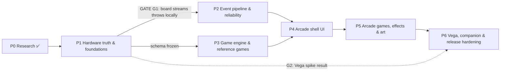

# AutoDarts Arcade — Roadmap

> **Companion documents:** [ARCHITECTURE.md](ARCHITECTURE.md) (design and evidence) · [RISK-REGISTER.md](RISK-REGISTER.md) (risks R01–R26).
> Phase 0 is complete when these three documents are accepted. Phases 1–6 below are the implementation roadmap. **No code or deployment happens until Phase 1 is approved.**

---

## Phase 0: Research and architecture (this deliverable) ✅

| Deliverable | Where |
|---|---|
| AutoDarts architecture, versions, licensing, integration methods | ARCHITECTURE §4.1–4.4 |
| ludarts / IO-Darts-Agent review (+ the projects that actually matter) | ARCHITECTURE §4.5 |
| Live dart, miss, correction, takeout and reconnection handling | ARCHITECTURE §6 |
| React (Native) / TypeScript architecture with a modular engine | ARCHITECTURE §5, §8 |
| Normalized event schema | ARCHITECTURE §7 |
| Raspberry Pi 4 assessment and rendering placement | ARCHITECTURE §4.6, ADR-001 |
| Six-phase roadmap | this file |
| Wireframes W0–W5 | ARCHITECTURE §10 |
| Technical risk register | RISK-REGISTER.md |

### Owner decisions needed before Phase 1 starts

| # | Question | Why it matters | Default if unanswered |
|---|---|---|---|
| **Q1** | **Which Fire TV Stick model(s) do you own or target?** | Fire OS sticks run the shared Android build. **Vega** sticks (4K Select 2025, HD 2026, 4K 3rd gen 2026) need a separate app track (R04) | Fire OS first; Vega spike in P1, build in P6 |
| **Q2** | Private use only (TestFlight / sideload), or public store listing? | A public listing needs Q3, Q4 and Q5 solved first (R03, R07, R08) | Private |
| **Q3** | Any commercial or venue use (BattleUp-style)? | Autodarts ToS §3.2/§6.1 require written permission (R03) | Non-commercial |
| **Q4** | Add a **GPLv3 §7 app-store exception** now, while you are the sole copyright holder? Or relicense? | It is cheap today and very hard after outside contributions (R07) | Add the exception in P1 |
| **Q5** | Product name for the shipped app | "AutoDarts" in an app name breaks store rules (R08) | Placeholder codename |
| **Q6** | Is upgrading the detection host (Pi 5 / mini PC) acceptable if the Pi 4 proves unreliable? | It is the only real fix for R11, and it needs no app change | Stay on Pi 4; measure in P1 |

---

## Dependency overview

- **P2 and P3 run in parallel** once the event schema (P1) is frozen. P3 develops against the simulator adapter and recorded fixtures, so it doesn't need P2's live adapter.
- **Vega track:** if Q1 says your main stick is Vega, the Vega shell moves from P6 into P4. P4's TV acceptance criteria then apply to Vega too.

| Phase | Depends on | Unblocks | Gate to exit |
|---|---|---|---|
| P1 | P0 accepted, Q1–Q6 answered or defaulted | P2, P3 | **G1** go/no-go on the local throw stream; **G2** Vega feasibility |
| P2 | P1 (G1 = go) | P4 | Chaos suite green |
| P3 | P1 (schema) | P4 | Replay-equivalence suite green |
| P4 | P2, P3 | P5 | Full game playable on every device class |
| P5 | P4 | P6 | Performance budgets met on the weakest target |
| P6 | P5 (+ G2) | release | Soak test, store / private-distribution readiness |

---

## Phase 1: Hardware truth and foundations

**Goal:** replace every 🔬 in the architecture with facts from *your* board and devices, and stand up the skeleton everything else builds on.

**Scope**
1. **Board probe** (`apps/devtools/board-probe`, runs on a laptop, read-only, nothing installed on the Pi):
   - version detection;
   - `GET /api/state` and `WS /api/events` capture;
   - an mDNS browse.
2. **Scripted capture sessions** → `fixtures/`. Each one is a scripted sequence of physical actions with a written expectation. They cover:
   - normal visits and all beds (T, D, S-in, S-out, 25, 50);
   - off-board misses and bounce-outs;
   - a dart that falls out mid-visit;
   - takeout with 0, 1, 2 and 3 darts;
   - a hand in front of the cameras;
   - manual reset;
   - Wi-Fi drop on the display side;
   - board-host reboot;
   - internet unplugged at the board.
3. **Pi health baseline:** CPU, temperature and per-camera FPS (from `/api/cams/stats` and the Pi's own tools) across a 30-minute session. Also impact → frame latency, filmed at 240 fps against the frame timestamps.
4. **Monorepo:** Yarn workspaces, TS strict, ESLint dependency rules (§5.3), Vitest, and CI (lint, typecheck, unit tests).
5. **`packages/event-schema` v1:** zod types, JSON Schema generation, validation of all fixtures through a *throwaway* normalizer.
6. **App skeleton** (`apps/arcade`, Expo + `react-native-tvos`):
   - builds for iPhone, iPad, Android phone and Fire OS (TV profile);
   - W0 connect screen;
   - a raw "dart ticker" that shows live darts from the board.
7. **Vega spike** (time-boxed, 3 days): a React Native for Vega hello-app that opens `ws://<board-ip>:3180/api/events` and renders a Reanimated + Lottie scene on a Vega stick or the Vega Virtual Device.
8. **Licence and name housekeeping** per Q4 and Q5. Add a `CONTRIBUTING.md` with the code-reuse rule (ARCHITECTURE §4.5).

**Acceptance criteria**
- [ ] **G1:** a written verdict on whether *your* board's version streams throws on `/api/events`, with the fixture that proves it. **No-go** triggers the contingency below.
- [ ] Every 🟡/🔬 row in ARCHITECTURE §11 is updated to ✅ or ❌ with evidence.
- [ ] ≥ 10 scripted fixtures are committed, each with an expectation file.
- [ ] The app installs and shows live darts on **iPhone, iPad, Android phone and a Fire OS stick**, with the iOS Local Network prompt handled.
- [ ] **G2:** a Vega spike report (works / works with caveats / blocked) plus the cost of the Vega track.
- [ ] The Expo SDK / `react-native-tvos` version is chosen and recorded as an ADR.
- [ ] CI is green on `main`.

**G1 no-go contingency** (the board doesn't stream throws locally), in order of preference:
1. Pin the detection host to the last version that does stream, and turn off auto-update. Feasibility to be confirmed in P1.
2. Ask Autodarts GmbH in writing for a supported local API or third-party authorization.
3. **Manual-entry arcade**: everything else in this roadmap still works.

The cloud API is *not* an option without written permission (R03).

**Tests:** schema validation of fixtures; CI smoke builds for each target; a manual device checklist.

---

## Phase 2: Event pipeline and reliability

**Goal:** a dart stream that never silently loses, duplicates or invents a dart. This answers brief item 3 in code.

**Scope**
- `packages/adapters`:
  - `autodarts-local`: snapshot diff, idempotency, normalization, resync, liveness, stuck-takeout detection;
  - `simulator`: scripted and random, including fault modes;
  - `manual`.
- `packages/platform`:
  - `Transport` with the **endpoint allowlist**;
  - `LogStore` (SQLite on Expo);
  - `Discovery`: mDNS, last-known, manual, probe.
- Session host core: seq assignment, write-ahead persistence, crash-resume, raw-frame ring buffer, diagnostics export.
- `apps/devtools/fault-proxy`: a laptop-side WebSocket proxy that drops, delays, duplicates and cuts frames between the board and the app.

**Acceptance criteria**
- [ ] **Golden replay:** each P1 fixture produces a byte-identical normalized log, committed as a golden file.
- [ ] **Chaos suite:** 1,000 seeded runs with random disconnects, duplicate frames, missed frames and reconnects at every point in a visit.
  - Final dart set equals the ground truth, **or** the affected turn is flagged `needsReview`.
  - **Zero** silent mismatches.
- [ ] Resync completes ≤ 2 s after the board becomes reachable, measured with the fault proxy.
- [ ] Killing the app mid-turn and relaunching restores the exact state. Resume ≤ 3 s on a Fire OS stick.
- [ ] Allowlist test: any request outside the allowed endpoints fails the build.
- [ ] Idle load on the board ≤ 1 HTTP request per 5 s.

**Tests:**
- Unit tests for the diff and normalization tables, including both miss shapes, both bull shapes and the missing `throws` key.
- Property tests: idempotency, and no duplicate `throwId`.
- Golden fixture tests and the chaos suite.
- On-device reconnect tests (airplane mode, board reboot, iOS background → foreground).

---

## Phase 3: Game engine and reference games

**Goal:** a pure, deterministic engine with a plugin game API, proven on well-known rules before inventing new ones.

**Scope**
- `packages/engine`: fold/replay, turn policy, commands, provisional finish, effect emission for new events only, and an optional snapshot cache.
- `packages/games`:
  - **Countdown** (x01 with in/out options);
  - **Cricket**;
  - **Around the Clock**;
  - one **party prototype** (Siege rules only, no art).
- Headless runner (`devtools`): plays any game from a fixture or script and prints standings.
- A game-authoring guide (`packages/games/README.md`).

**Acceptance criteria**
- [ ] Each game has a rules test suite derived from its `rules.md`, with 100 % branch coverage of `module.ts`.
- [ ] **Replay equivalence** (property test): for any generated session and any dart *k*, throwing a wrong value and then correcting it to *v* ends in the same state as throwing *v* in the first place. The same holds for void and add.
- [ ] **Determinism:** the same log and seed produce identical state, on Node and on device.
- [ ] Refolding a 1,000-dart log takes ≤ 5 ms on a Fire OS stick (release build). If not, the snapshot cache is enabled and re-measured.
- [ ] A new trivial game can be added with one folder and one registry line (checked by a sample PR).

**Tests:** Vitest unit tests, fast-check properties, and fixture-driven game tests using P1 recordings. Engine micro-benchmarks run on device.

---

## Phase 4: Arcade shell UI

**Goal:** the full player journey from W0 to W5, on every device class, with both touch and D-pad.

**Scope**
- Screens W0–W5 (ARCHITECTURE §10). `ui-kit` includes:
  - focus-aware components (`TVFocusGuideView`);
  - the dartboard picker (SVG);
  - theme and player colours (colour-blind-safe palette).
- Correction flow with **dry-run preview**; provisional results; "needs review" badges.
- Player profiles (local), guests, settings (quality tier, house rules, board control opt-in).
- Basic audio through `AudioPort`; keep-awake; Home → pause on TV.
- **Demo mode** (simulator) for development and App Review.
- *Vega shell joins here if Q1 says Vega.*

**Acceptance criteria**
- [ ] A complete Countdown and Cricket session can be played end-to-end:
  - **with D-pad only** on a Fire OS stick;
  - **with touch only** on iPad and on an Android phone;
  - on iPhone.
- [ ] The common corrections (wrong bed, miss ↔ hit, add a bounce-out, void a false dart) take **≤ 5 remote presses** from W3.
- [ ] A correction that changes the winner withdraws the victory screen and resumes play correctly.
- [ ] The Amazon TV test criteria pass a self-audit:
  - D-pad navigation everywhere;
  - Back always works;
  - 90 % screen fill;
  - readable from 10 ft;
  - Home shows "Game paused".
- [ ] iOS: denying and then re-granting Local Network permission is handled with clear guidance.
- [ ] Accessibility: player identity is never conveyed by colour alone; text remains legible at the largest phone font scale.

**Tests:**
- Component tests (React Native Testing Library).
- E2E flows driven by the simulator adapter on the iOS simulator, Android emulator and Android TV emulator. The tool is Maestro or Detox, chosen in P1 ⚪.
- A manual acceptance script on the four real devices.

---

## Phase 5: Arcade games, effects and art

**Goal:** the "premium arcade" feel: original party games, celebration effects and sound, within budget on the weakest TV.

**Scope**
- `packages/effects`:
  - effect queue with collapse rules;
  - animation presets (Reanimated, SVG, Lottie);
  - Skia v2 particles on the High tier (not on Vega);
  - quality-tier auto-selection.
- Games: **Siege**, **Territory**, **Balloon Pop** (all original), with stage renderers and their own rules tests.
- **Original asset pipeline:**
  - style guide;
  - an `ASSETS.md` provenance log (author, tool, licence for every file);
  - an originality check against BattleUp's public catalogue;
  - sound design with a licence on file.

**Acceptance criteria**
- [ ] **Fire OS 2 GB stick, Standard tier:**
  - foreground memory < 300 MB;
  - cold-start TTFF < 2 s;
  - no dropped dart events during a 3-dart celebration storm.
- [ ] **1 GB stick, Lite tier:** foreground memory < 300 MB (Fire OS) or < 400 MiB (Vega); UI fluidity ≥ 99 % in Amazon's KPI tooling.
- [ ] **iPad:** 60 fps sustained through the victory celebration (Instruments).
- [ ] A dart is shown on screen ≤ 150 ms after its frame arrives, on all tiers, even during effects.
- [ ] Every shipped asset has a provenance entry. There are no third-party marks or look-alike game names.

**Tests:** on-device performance runs (release builds) with recorded traces; visual snapshot tests for stage components; rules tests per game.

---

## Phase 6: Vega, companion and release hardening

**Goal:** finish the device story, add the phone companion, and make it robust enough for a 4-hour party.

**Scope**
- **Vega app** (`apps/vega`): the shared packages plus `*.kepler.tsx` platform files, the Vega `AudioPort`, AsyncStorage `LogStore` and manual discovery. This only happens if G2 was "works" or "works with caveats", and is skipped if it already landed in P4.
- **Phone companion** (optional): a LAN server in the host app, QR pairing with a one-time token, and commands for name entry, corrections and operator actions.
- **Soak and resilience:** 4-hour simulated sessions with periodic board and Wi-Fi drops.
- **Distribution:**
  - *Private:* TestFlight internal, Play internal testing, Fire OS sideload, and Amazon Live App Testing for Vega ⚪.
  - *Public:* only if Q2 says so, and only after Q3, Q4 and Q5 and written Autodarts permission. That route needs store listings, privacy labels, a review demo video and the demo mode.
- User documentation: setup, troubleshooting, and the "your board updated and something broke" playbook.

**Acceptance criteria**
- [ ] 4-hour soak: no crash, memory growth < 10 %, and no unflagged dart discrepancy against the simulator's ground truth.
- [ ] Vega build meets the Vega KPIs (TTFF < 1.5 s, foreground < 400 MiB, fluidity > 99 %), *or* there is a documented decision not to ship Vega.
- [ ] Companion: pairing in under 30 s, and a correction from the phone shows on the TV in under 500 ms on the same LAN.
- [ ] The chosen distribution path is completed end-to-end on every target device.
- [ ] Runbook: re-running the P1 probe and the golden fixtures against a new Autodarts version takes under 30 minutes.

---

## Testing strategy (all phases)

| Layer | What | Tooling | Runs |
|---|---|---|---|
| Schema | Every event and fixture validates; schema changes are versioned | zod, JSON Schema | CI |
| Unit | Normalizer tables, diff algorithm, turn policy, game rules | Vitest | CI |
| Property | Replay equivalence, determinism, adapter idempotency, no duplicate IDs | fast-check | CI |
| Golden / contract | Recorded **real-board** fixtures → normalized logs; re-run per Autodarts version | Vitest + `fixtures/` | CI + on board update |
| Chaos | Disconnect, duplicate, drop and delay at every visit point | simulator + fault-proxy | CI (simulated), weekly (real board) |
| Component | Screens and focus order | RN Testing Library | CI |
| E2E | Scripted journeys W0→W5 on simulator / emulators incl. Android TV | Maestro or Detox (P1 pick) ⚪ | CI nightly |
| Device | Manual acceptance on iPhone, iPad, Android phone, Fire OS stick (+ Vega) | checklists in `docs/qa/` | each phase exit |
| Performance | TTFF, memory, fluidity, frame→pixel latency | Xcode Instruments, Android profiler / Perfetto, Amazon KPI tooling | P4–P6 exits |
| Soak | 4-hour sessions | simulator on device | P6 |

**Board-version watch:** Autodarts auto-updates (R01). Whenever the board's `/api/version` changes, the app shows a one-time "Board updated: run the check?" prompt. The `devtools` probe re-runs the golden fixtures in under 30 minutes.
