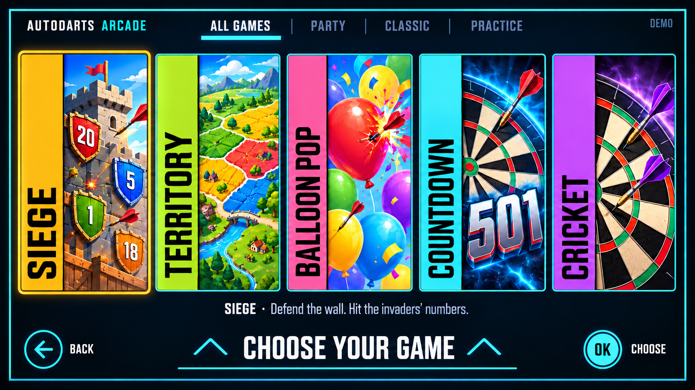
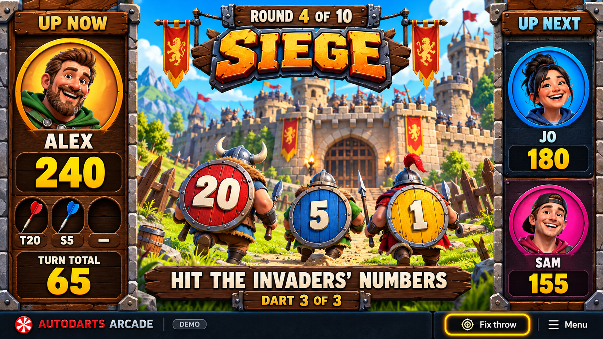

# AutoDarts Arcade visual redesign for Claude

Owner-requested investigation and mockups, 26 October 2026. **Proposed direction, awaiting visual approval; not implemented.**

The owner wants the UI and graphics to closely match the 501 FUN / SMARTS interactive darts experience, ideally one-to-one. The owner has clarified the venue as **LEVELS in Prague**. These files are published so Claude can review them remotely; they are not changes to the app or an approval of the current GUI.

## Main finding

Reopen **Phase 0's visual-design acceptance**, while retaining the useful system architecture and engine contracts. The checked-off phase contains low-fidelity wireframes, but does not establish that the current appearance matches the intended experience. The roadmap leaves much of the arcade presentation until Phase 5, allowing an unapproved visual direction to become the working shell.

The inspected implementation is `phase-1/finish` at `be86d2fa26e1a4a63ec33aef52fb9b6303d6c709`. Findings are from source inspection, not a running Android build.

| Evidence | Current state | Proposed direction |
|---|---|---|
| `ARCHITECTURE.md` §10 | Low-fidelity W0–W5 wireframes | Approve high-fidelity screens and transitions against the intended reference |
| `packages/ui-kit/src/GameTileArt.tsx` | Procedural landscape artwork on a 160×100 canvas | Tall illustrated game posters with distinctive title strips |
| `packages/ui-kit/src/theme.ts` | Shared dark navy/gold interface | Shared navigation styling plus game-specific art, typography and themed framing |
| `apps/arcade/src/app/play.tsx`, `const stage` | Generic dartboard and last-hit text | Game-specific visual stage with clear current player and opponent queue |
| `ROADMAP.md` Phase 5 | Style guide, arcade art, effects and stage renderers largely deferred | Approve representative art now; stage implementation and performance work separately |

## Game selection mockup

Follows the observed SMARTS selection composition: tall colourful cards, vertical title strips, dark background, cyan framing and a prominent selection prompt. A gold outline marks remote focus.

**Proposed interaction change:** All games is an added category, allowing this mixed catalogue. Party, Classic and Practice must filter the carousel when selected. Do not put these mixed categories under a selected Party tab.

## Live play mockup

Uses the existing AutoDarts Siege concept to demonstrate the reference's presentation structure: large current-player panel, illustrated centre stage, upcoming-player column, large scores and a short next-action instruction. The scene is illustrative; targets, scoring and animations must follow the actual game module rather than this image.

## Reference confidence and remaining work

The public SMARTS selection photograph and gameplay sheet below establish the visual composition used here. The [501 FUN product page](https://www.501fun.com/our-products/interactive-darts) describes a big-screen TV plus a separate touchscreen console. AutoDarts therefore needs remote-operable controls integrated with the TV presentation rather than simply copying the touchscreen interaction.

The owner confirmed **LEVELS Prague**, but the precise installed vendor/version has not been independently established. Its [official darts page](https://www.levelsprague.com/en/darts) describes interactive scoring, game modes and visual effects, without identifying SMARTS. Do not label these mockups a verified reproduction of the venue's actual software. An earlier transcript mentioned “Frog”; no matching game was reliably identified, so no Frog rules or artwork have been invented. Confirm the exact intended screen/game from venue material or the owner before pursuing a one-to-one match.

These static images establish an initial art direction, not final assets or tested layouts. Both put some functional content too close to the screen edges. Move controls, card focus outlines and essential text inside a 5% safe area (96 px horizontal and 54 px vertical at 1920×1080); decorative art can remain full bleed. Distinguish decorative avatar rings from the single actual remote-focus indicator.

## Next design deliverable

| Screen | What needs visual and interaction approval |
|---|---|
| W0 Connect | Arcade welcome, obvious primary action and secondary connection details |
| W1 Games | Illustrated carousel, category behaviour, focused-game details and focus routes |
| W2 Players | Large player/avatar slots, turn order, Guest/recent names, accessible reorder/remove and options |
| W3 Play | Per-game stages; throw, hit, takeout and next-player states; pause, offline, review and stuck states |
| W4 Fix | Clear paused correction, selected dart, before/after preview, Apply/Cancel and measured remote press count |
| W5 Victory | Themed celebration, standings, Rematch/New game/Main menu and Fix last turn |

Approve TV/landscape layouts first, then portrait adaptations. Specify one visible focus indicator, D-pad routes, return focus, sensible Back behaviour, readable text and the five-press common-correction target. Keep simulator Throw/Board clear/Auto controls in a clearly identified demo/debug surface.

Preserve owner decision **R**: uncertain offline takeout pauses play for human confirmation; missing darts are not invented as misses, and an unconfirmed flagged turn cannot close as completed. Preserve **S**: the app never writes to the board.

Android TV navigation remains untested: the Shadow PC emulator acceleration check failed with “Virtualization extension is not supported.” Images do not prove focus, performance, animation or lifecycle behaviour.

## Handoff instruction

Reopen the visual-design approval within Phase 0. Review these mockups with the owner and establish the exact LEVELS Prague reference. Produce high-fidelity W0–W5 designs, representative game stages and motion samples, and TV focus maps before implementing a comprehensive GUI overhaul. Retain the engine, board contracts and decisions R/S. Do not treat the existing generic demo shell or these generated compositions as final approved GUI specifications.

## Sources and asset provenance

- [501 FUN Interactive Darts](https://www.501fun.com/our-products/interactive-darts): official product description and separate TV/touchscreen arrangement.
- [SMARTS product page](https://www.homeleisuredirect.com/commercial-games-room-products/interactive-darts/smarts-interactive-darts.html): public menu and gameplay reference material.
- [Menu reference photograph](https://www.homeleisuredirect.com/Assets/HLD/User/52469-Interactive-Darts-Commercial-Installation-Smart-Screen.jpg).
- [Gameplay reference sheet](https://www.homeleisuredirect.com/Assets/HLD/User/49370-InteractiveDarts-GameScreenshots.jpg).
- [FN Leisure SMARTS description](https://www.fnleisuresolutions.com/smart-darts?lang=en): relationship to 501 Entertainment and touchscreen setup flow.
- [LEVELS Prague darts](https://www.levelsprague.com/en/darts): owner-identified venue; not confirmation of a specific vendor.

The two PNGs were generated using the built-in image tool with public SMARTS images as composition/style references. Exact prompts are in [generation-prompts.txt](generation-prompts.txt). Reference photographs are linked, not bundled or installed as application assets. Generated images are review concepts, not cleared production artwork. No application source or existing architecture/roadmap/risk-register document is changed by this branch.
